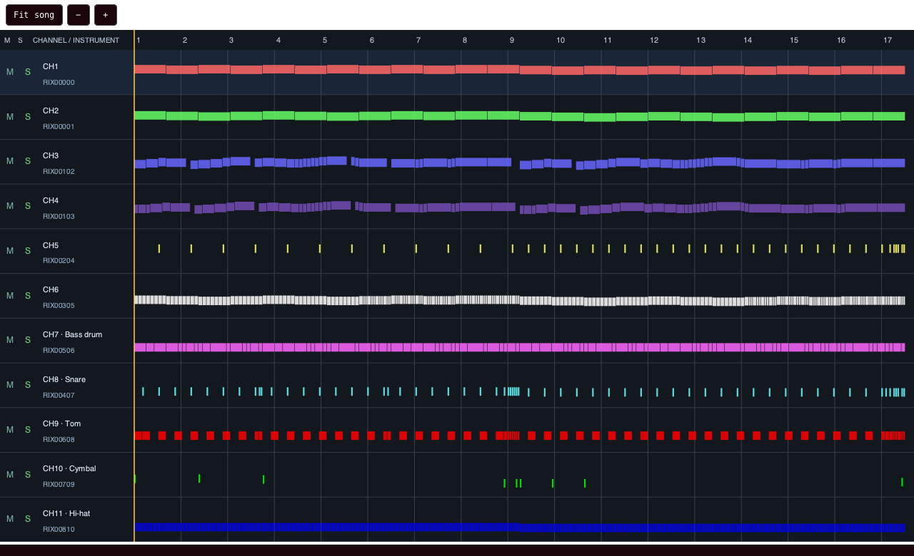
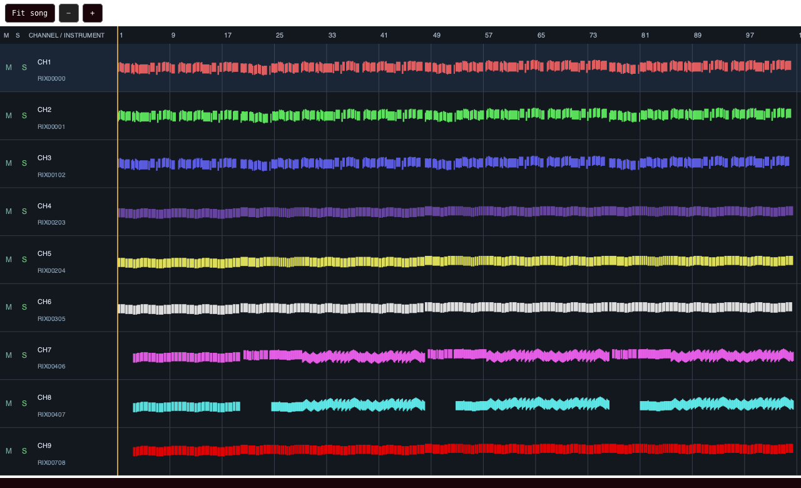

# AdVisual · PAL RIX editor

A desktop AdLib / OPL music editor with a full-song, all-channel arrangement view for the DOS version of **仙剑奇侠传 / PAL**. This fork extends [RobertP-McDowell/AdVisual](https://github.com/RobertP-McDowell/AdVisual).



## Download

[**v1.1.0 releases for Windows and macOS**](https://github.com/othercat/AdVisual/releases/tag/v1.1.0)

- **Windows x64:** extract the complete portable ZIP, then open `advisual.exe`.
- **macOS Apple Silicon, macOS 15+:** extract the ZIP and open `AdVisual.app`. GTK, AdPlug, and supporting runtime resources are included; Homebrew is only needed for source builds. The app is ad-hoc signed, without Developer ID signing or Apple notarization.
- Corresponding source, third-party notices and checksums accompany the release. No PAL game music is bundled.

## Open, play and edit

Open a PAL `.RIX` with **Load / Ctrl+L**. Its embedded instruments are imported with the music; no external bank is needed. The default **All channels** view fits every active voice vertically: nine melodic channels, or six melodic voices plus Bass drum, Snare, Tom, Cymbal and Hi-hat.

- **Fit song** shows the complete song. **+ / −** or Ctrl+scroll zoom the shared timeline; scroll or use the bottom scrollbar to navigate.
- Click a note to select it. Drag it to move its start, or drag its right edge to change its length. Left/Right move one tick, Up/Down transpose one semitone, Alt+Left/Right move one bar, Shift+Left/Right change length, and Delete/Backspace erases it.
- Edits stay in the same mono channel. Moving across another note overwrites that portion. **Ctrl+Z / Ctrl+Shift+Z** undo and redo, including overwritten notes.
- **M / S** in each lane mute or solo immediately. Click S again to restore the previous mix; the M/S keys act on the selected lane.
- Click the ruler to position the playback cursor or seek while playing. The view follows playback when zoomed in. Pause before changing notes or events.
- Double-click a note, or turn off **All channels**, for the detailed piano editor and its instrument, volume, pitch and tempo events. Both views share the song and undo history.
- **Save / Ctrl+S** writes an editable `.ROL` and companion `.BNK`. Opening a ROL also loads a same-name BNK when present. The original RIX is preserved; writing edited RIX files is not implemented.

Playback defaults to **Nuked OPL in OPL2 compatibility mode**, without surround detuning. This fork also corrects stereo frame offsets, channel muting, playback-to-UI synchronization and paired ROL/BNK saving.



## RIX timing and limits

Direct import uses the finest 1, 2 or 4 ms grid that fits a song in ROL's 65535-tick range. For the 86 PAL songs, the largest rounding error is 2 ms. The ruler's 120 BPM is a display timebase, not a recovered musical tempo map. ROL pitch bend remains an approximation of the RIX curve.

For a reconstructed musical tempo map, open the ROL + BNK generated by [palresearch's rixrol.py](https://github.com/palxex/palresearch/tree/43580c4455944505be9a252749c1e4dfee0a5466/rix/RIXROL). For standalone preview and WAV/MP3 export, the companion [RixConverter](https://github.com/othercat/RixConverter) provides a dedicated PAL RIX player; that repository currently requires access permission.

## Build and validate

C++20, CMake, GTKmm 4, AdPlug and libbinio are required. On macOS these development dependencies are available through Homebrew. See [COMPILING.txt](COMPILING.txt) for the original Linux build notes, and [.github/workflows/release-build.yml](.github/workflows/release-build.yml) for current macOS and Windows release builds.

```sh
cmake -S . -B bin -DCMAKE_BUILD_TYPE=Release -DCMAKE_INSTALL_PREFIX="$PWD/bin/local"
cmake --build bin -j 4
cmake --install bin
bin/local/bin/advisual
cmake --build bin --target package-portable
cmake --build bin --target check-portable
```

The PAL regression test uses your own corpus, which is never included in the repository:

```sh
bin/pal_editor_test /path/to/PAL/RIX /path/to/temporary/test-output
```

The local regression covers all 86 songs, 1008 instrument records, ROL/BNK round trips, note movement/overwrite/resize/delete, undo/redo and actual GTK rendering. Release CI also checks runtime resources from a relocated folder. Listening and cross-machine acceptance remain tracked in [Issue #1](https://github.com/othercat/AdVisual/issues/1).

The original Composer and instrument editor remain available. Press **F1** or read [docs.txt](docs.txt) for the original guide; **F2** opens settings and shortcuts. The [samples](samples) directory contains example ROL songs and a bank.

## Credits and license

Based on AdVisual by RobertP-McDowell and contributors; see [LICENSE.txt](LICENSE.txt). Third-party audio and GTK components retain their own licenses and notices, included in the portable package. Report issues for this fork in [othercat/AdVisual issues](https://github.com/othercat/AdVisual/issues).
